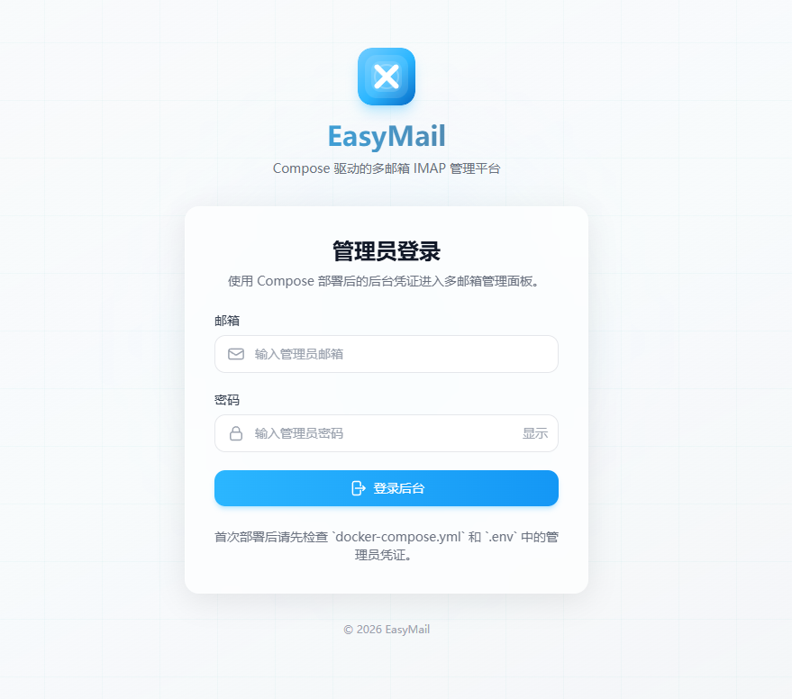
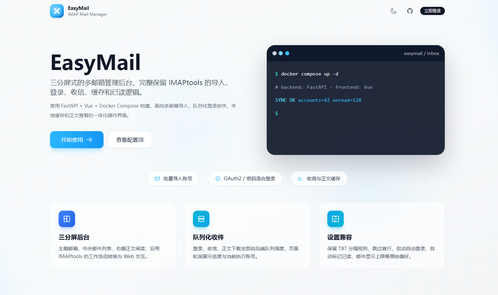
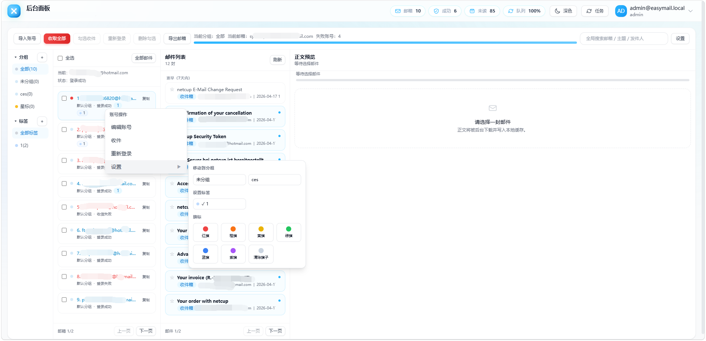

<h1 align="center">
  
  <br />
  EasyMail
</h1>

<div align="center">
  多邮箱账号的统一收件、管理与日志排查平台
</div>

## 简介

EasyMail 是一个基于 `FastAPI + Vue 3` 的多邮箱管理平台，面向 Outlook / Hotmail / IMAP 邮箱的批量导入、登录、收发件、附件下载、正文翻译、验证码提取、分组标签管理、任务调度与日志排查。

## 功能特性

- **多邮箱批量管理**：支持自定义分隔符批量导入、Outlook `Graph API -> IMAP` 自动回退、重启保留登录态与分组锁定防误操作
- **现代工作台与实时刷新**：紧凑响应式工作台、浅/深色模式、邮件切换骨架屏过渡、SSE 实时推送与手动收件独立快通道
- **邮件阅读与管理**：支持单封/批量永久删信（同步远端 Graph/IMAP）、批量设为已读、标星、HTML/纯文本切换（默认拦截远程追踪图片）
- **完整附件下载**：邮件列表自动标注附件图标，详情页支持单个附件下载与多附件一键打包 ZIP 下载（按需拉取，不占用本地数据库空间）
- **Web 端直接发信**：Outlook / Hotmail OAuth 账号支持通过 Microsoft Graph `Mail.Send` 直接发送邮件（多收件人与抄送，权限不足时一键引导重新授权）
- **智能验证码提取 & 多引擎翻译**：自动识别并一键复制验证码；内置多通道免费翻译（自动降级）及 DeepL / DeepSeek / OpenAI / 硅基流动 / Google Cloud 官方翻译 API
- **按分组自动收件与提速同步**：支持按分组独立设置收件间隔（`0` 仅手动，最低 30 分钟）、失败账号自动暂停、Graph/IMAP 增量拉取及 IMAP 批量拉取邮件头
- **Token 轮换与到期保活**：自动追踪 Refresh Token 轮换与预计到期时间，支持「按到期窗口每日检查」与「固定周期全量刷新」
- **通知、备份与运维**：支持 Telegram 即时/汇总通知（内置去重防刷屏）、账号定时备份与恢复、结构化日志及 SQLite 自动清理回收
- **开放 API（`/api/v1`）**：支持细粒度权限 API Key 的创建、启用/禁用与删除，详见 [API 文档](./API_doc.md)

## 预览

<div align="center">
<table>
  <tr>
    <td align="center"><strong>登录页</strong></td>
    <td align="center"><strong>首页</strong></td>
    <td align="center"><strong>后台</strong></td>
  </tr>
  <tr>
    <td align="center"></td>
    <td align="center"></td>
    <td align="center"></td>
  </tr>
</table>
</div>

## 快速开始

### 1. 部署运行

```bash
mkdir -p /root/EasyMail && cd /root/EasyMail && nano docker-compose.yml
```

```yaml
services:
  easymail:
    image: vivibudong/easymail:latest
    restart: unless-stopped
    environment:
      DATA_DIR: /app/data
      CORS_ORIGINS: http://localhost:3000,http://127.0.0.1:3000
    volumes:
      - ./data:/app/data
    ports:
      - "3000:8000"
```

```bash
docker compose up -d && docker compose logs -f
```

首次启动日志会打印一次默认管理员邮箱与密码，请登录后在后台安全设置中及时修改；如通过域名反向代理访问，建议将 `CORS_ORIGINS` 修改为对应访问域名。

启动后访问：

- `http://IP:3000`

### 2. 版本更新

```bash
cd /root/EasyMail && docker compose pull && docker compose up -d
```

> 提示：历史导入的 Outlook 令牌若仅包含只读权限，首次使用「写邮件」或 Graph 删信功能时，在账号右键菜单点击一次「Graph 重新授权」即可补齐 `Mail.ReadWrite` 与 `Mail.Send` 权限。

## License

This project is licensed under the [MIT License](LICENSE), allowing free use, modification, and distribution with proper attribution.

## Contact

For issues or suggestions, open an issue on GitHub or reach out via email: budongkejivivi@gmail.com

<div align="center"> <strong>Made with ❤️ by <a href="https://github.com/vivibudong">Vivi不懂</a></strong> </div>

## Star History

[](https://www.star-history.com/?repos=vivibudong%2FEasyMail&type=date&legend=top-left)


